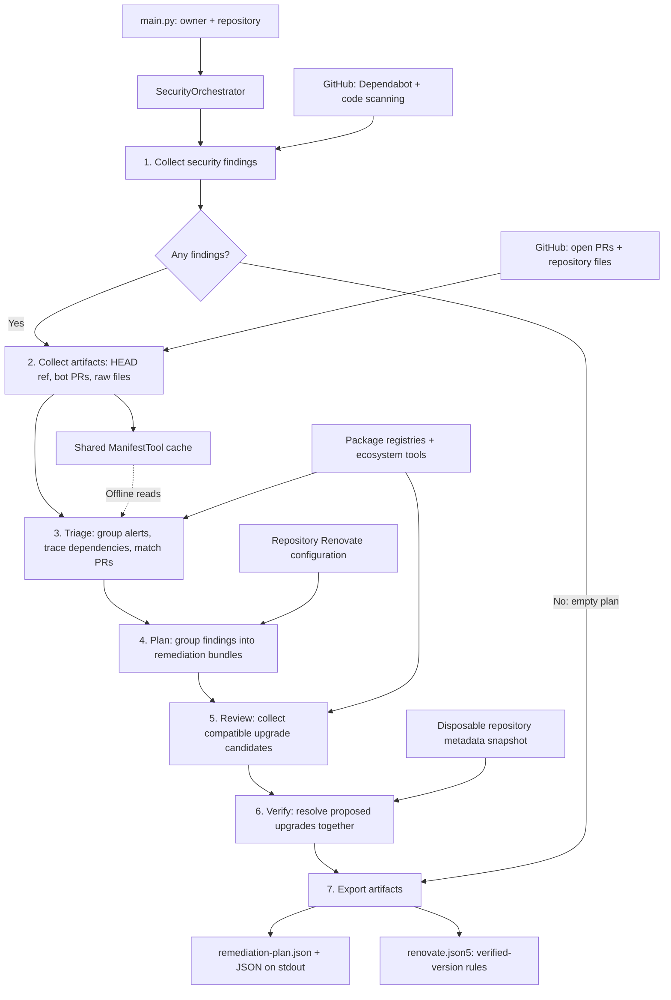

# Security Remediation Agent

A deterministic Python workflow that reads GitHub security findings, identifies dependency upgrade options, checks compatible candidates, and exports a remediation plan and Renovate rules. The classes named `Agent` coordinate tools and resolvers; the default pipeline does not require an LLM or an OpenAI API key.

## Architecture



Repository file reads share a run-scoped `ManifestTool`. Artifact collection tries to pin HEAD once and prefetches manifests and lockfiles. Triage reads an offline view of that cache; a missing file does not trigger a GitHub fetch from triage. Planning, review, verification, and reporting may fetch additional repository metadata at the selected reference. If pinning fails, the run continues without a pinned reference.

## How it works

1. **Collect findings.** Fetch open Dependabot alerts and code-scanning alerts concurrently. Code-scanning collection retains the `LanguageSpecificPackageVulnerability` rule. Counts and collection errors are recorded in the summary. One failed source allows partial processing; failure of both sources stops the run.
2. **Collect repository evidence.** Fetch open bot PRs, parse version changes from their titles and bodies, and cache raw manifests and lockfiles. Dependency-review API extraction is available through the PR tool but disabled by default. Raw files are parsed later by the ecosystem resolvers.
3. **Triage each package.** Group Dependabot alerts by ecosystem, package name, and manifest path. Preserve advisory details and determine a fixed-version target. Use available dependency graphs to identify installed occurrences and the parents that introduce vulnerable transitive packages. Match existing PRs to upgrade targets. Missing evidence leaves findings unresolved rather than dropping them.
4. **Build bundles.** Apply the repository's supported Renovate grouping rules when a usable configuration is present. Otherwise, group by ecosystem and upgrade type: major, minor, patch, or unknown. Each bundle carries the highest severity among its packages and retains the original triage evidence.
5. **Review candidates.** Select an npm, Python, or .NET reviewer. Recommendations record qualifying upgrade versions and derive the minimum patched, highest stable, and compatible same-major versions. Candidate collection and successful verification are separate steps.
6. **Verify upgrades together.** Select eligible stable, newer, same-major candidates backed by the recommendation evidence. Resolve upgrades for the same project together, even when they came from different bundles. npm workspaces resolve at their workspace root. Only successful resolution with the requested exact versions sets `verified_version` and `verification_status: resolution_verified`.
7. **Export results.** Write the complete plan, including unresolved findings, to `remediation-plan.json`. Fetch the source Renovate configuration and preserve its user-authored rules while replacing this generator's previous rules. Append exact-version rules only for verified recommendations. Return the plan to the CLI for JSON output.

Code-scanning findings contribute to the collection summary; package triage currently builds its package list from Dependabot alerts.

## Example: a transitive vulnerability

Suppose `web/package-lock.json` shows `app -> parent@1.0.0 -> vulnerable-lib@2.0.0`, and Dependabot reports a fix in `vulnerable-lib@2.0.1`.

The workflow records the dependency path and searches for parent upgrades whose dependency evidence addresses the vulnerable library. If `parent@1.1.0` qualifies, the reviewer can select it as a compatible candidate. Verification proposes that parent upgrade alongside the project's other candidates in a temporary snapshot. If resolution succeeds and includes the exact candidate, the output can constrain Renovate to `parent@1.1.0` for `web/package.json`. If verification fails, the finding and its evidence remain in the plan without a verified-version rule.

## Run locally

Requirements:

- Python 3.10 or newer and [uv](https://docs.astral.sh/uv/).
- A `GITHUB_TOKEN` with access to the target repository's contents, pull requests, Dependabot alerts, and code-scanning alerts. Organization and repository settings also control alert access.
- Ecosystem tools needed by the target project: npm for npm processing, uv for Python resolution, and the .NET SDK for .NET review. Registry access may be needed for candidate collection and resolution.

From the repository root, using PowerShell:

```powershell
cd security-remediation-agent
uv sync --extra dev --no-install-project

$env:GITHUB_TOKEN = "<token>"
$env:LOG_LEVEL = "INFO"
uv run --no-sync python main.py --owner example-org --repo example-repo
```

The CLI also accepts a GitHub repository URL for `--repo`. Logs go to stderr; the returned plan is printed as JSON on stdout. Set `LOG_LEVEL=DEBUG` for detailed diagnostics.

Outputs are written in the **current working directory**. Run from a directory where generating or replacing `renovate.json5` and `remediation-plan.json` is intended. The Renovate output is generated from the target repository's configuration; it is not a merge with an arbitrary local file of the same name.

## Outputs and downstream use

| Output | Contents | Consumer |
| --- | --- | --- |
| `remediation-plan.json` | Bundles, package findings, advisories, dependency occurrences, PR matches, recommendations, verification results, and summary | Reviewers and downstream automation |
| `renovate.json5` | Source configuration plus exact-version rules for verified recommendations; serialized as JSON, which is valid JSON5 | Renovate, after the configuration is integrated into the target repository |
| stdout | Serialized returned remediation plan | CLI callers and workflow steps |

The Python CLI writes local artifacts. Publishing configuration, creating tracking issues, and running Renovate are downstream actions. See the repository's [GitHub remediation workflow](../.github/workflows/security-vulnerability-remediation.yml) and [issue creation script](../.github/scripts/security-remediation/create-issues.js) for the surrounding integration.

## Verification scope

| Project format | Resolution check |
| --- | --- |
| npm with v2/v3 package-lock data, including workspaces | `npm install --package-lock-only --ignore-scripts --no-audit --no-fund` in a disposable snapshot |
| Python requirements and supported PEP 621 projects | Joint `uv pip compile` resolution with `--no-build --only-binary :all:` |
| Native Poetry, uv workspaces, Yarn, and NuGet | Verification unsupported; candidate collection is independent |

Verification can use the network and download metadata or binary distributions. It checks dependency resolution on the runner's platform and Python version. It does not install the project, execute its builds or tests, or independently rescan advisories. Missing tools, unsupported formats, conflicting candidates, or failed resolution leave recommendations unverified. Breaking candidates are deferred by the current verification policy.

See [verification details](src/engines/remediation_verification/README.md) for the engine behavior.

## Source map

| Location | Responsibility |
| --- | --- |
| `main.py` | CLI arguments, logging, shared tool setup, JSON output |
| `src/orchestrator/security_orchestrator.py` | Stage ordering, plan validation, stage-specific errors |
| `src/agents/` | Collection, triage, planning, review, verification, and artifact coordination |
| `src/tools/` | GitHub alert and PR tools, raw repository file cache, API pagination |
| `src/engines/resolvers/` | Dependency relationships, PR version extraction, upgrade recommendations |
| `src/engines/reviewers/` | Ecosystem-specific compatible candidate collection |
| `src/engines/remediation_verification/` | Disposable snapshots and joint dependency resolution |
| `src/models/` | Findings, triage evidence, recommendations, bundles, and summary models |
| `tests/` | Unit tests and mocked pipeline integration tests |

## Tests

From `security-remediation-agent/`:

```powershell
uv run --no-sync python -m pytest -q -p no:cacheprovider
```

From the repository root, run the JavaScript issue-generation tests:

```powershell
node --test .github/scripts/security-remediation/*.test.js
```

The tests cover API pagination, collection failures, cache behavior, dependency paths, version evidence, grouping, verification, artifact generation, and orchestrator wiring. Mocked resolution checks do not replace builds and tests of the target application.
