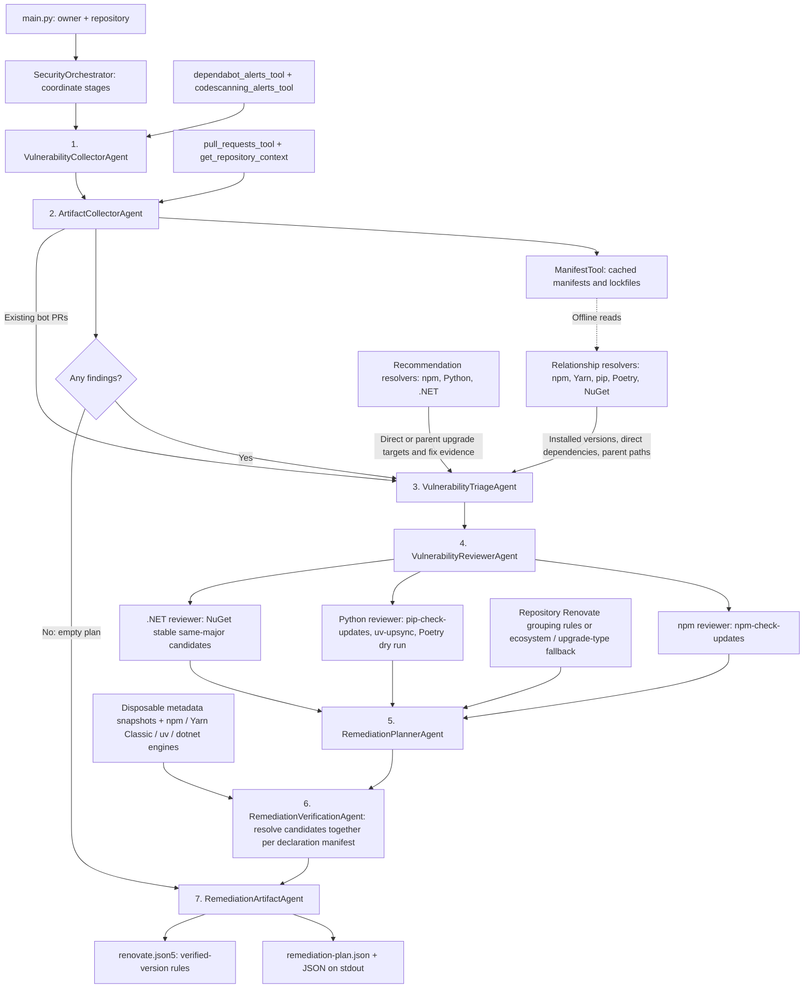

# Security Remediation Agent

A deterministic Python workflow that reads GitHub security findings, identifies dependency upgrade options, checks compatible candidates, and exports a remediation plan and Renovate rules. The classes named `Agent` coordinate tools and resolvers; the default pipeline does not require an LLM or an OpenAI API key.

## Architecture



Repository file reads share a run-scoped `ManifestTool`. Artifact collection uses the configured reference or looks up the repository's default branch, then prefetches manifests and lockfiles. It does not pin a commit SHA; failure to retrieve the required repository context stops collection. Triage reads an offline view of the cache; a missing file does not trigger a GitHub fetch from triage. Planning, review, verification, and reporting may fetch additional repository metadata at the selected reference.

See [Agents and tools](AGENTS_AND_TOOLS.md) for each agent, tool, reviewer, and engine's responsibility.

## How it works

1. **Collect findings.** Fetch open Dependabot alerts and code-scanning alerts concurrently. Code-scanning collection retains the `LanguageSpecificPackageVulnerability` rule. Counts and collection errors are recorded in the summary. One failed source allows partial processing; failure of both sources stops the run.
2. **Collect repository evidence.** Fetch open bot PRs, parse version changes from their titles and bodies, and cache raw manifests and lockfiles. Dependency-review API extraction is available through the PR tool but disabled by default. Raw files are parsed later by the ecosystem resolvers.
3. **Triage each package.** Group Dependabot alerts by ecosystem, package name, and manifest path. Preserve advisory details and determine a fixed-version target. Use available dependency graphs to identify installed occurrences and the parents that introduce vulnerable transitive packages. Match existing PRs to upgrade targets. Missing relationship evidence leaves findings unresolved; collection can exclude alerts whose manifests are absent from the repository tree.
4. **Review candidates.** Select an npm, Python, or .NET reviewer before final grouping. Recommendations retain security-fix evidence and collect compatible upgrade candidates. Reviewers can also add optional non-vulnerable updates. Candidate collection and successful verification are separate steps.
5. **Build bundles.** Apply the repository's supported Renovate grouping rules when a usable configuration is present. Otherwise, group by ecosystem and upgrade type: major, minor, patch, or unknown. Each bundle carries the highest severity among its packages and retains the original triage evidence.
6. **Verify upgrades together.** Resolve qualifying candidates for the same declaration manifest together, even across bundles. Duplicate package recommendations must share a qualifying version. Failed candidates can retry at a shared reviewed compatible version alongside accepted upgrades. Verification is not restricted to same-major upgrades. Accepted versions populate `triage.verified_versions[package]`; npm uses successful resolver exit, while Python and NuGet also check the resolved versions.
7. **Export results.** Write the complete plan, including unresolved findings, to `remediation-plan.json`. Fetch the source Renovate configuration and preserve its user-authored rules while replacing this generator's previous rules. Append exact-version rules only for verified recommendations. Return the plan to the CLI for JSON output.

Code-scanning findings contribute to the collection summary; package triage currently builds its package list from Dependabot alerts.

## Example: a transitive vulnerability

Suppose `web/package-lock.json` shows `app -> parent@1.0.0 -> vulnerable-lib@2.0.0`, and Dependabot reports a fix in `vulnerable-lib@2.0.1`.

The workflow records the dependency path and searches for parent upgrades whose dependency evidence addresses the vulnerable library. If `parent@1.1.0` qualifies, the reviewer can select it as a compatible candidate. Verification pins that parent upgrade alongside other candidates for `web/package.json` in a temporary snapshot. If npm resolution succeeds, the output can constrain Renovate to `parent@1.1.0` for that manifest. If verification fails, the finding and its evidence remain in the plan without a verified-version rule.

## Run locally

Requirements:

- Python 3.10 or newer and [uv](https://docs.astral.sh/uv/).
- A `GITHUB_TOKEN` with access to the target repository's contents, pull requests, Dependabot alerts, and code-scanning alerts. Organization and repository settings also control alert access.
- npm and `npx` for npm relationships, review, and verification; Yarn for Yarn relationship analysis; npm/npx also runs the pinned Yarn Classic verifier.
- For Python review, `pcu` (pip-check-updates) or `uvx` for requirements, `uvx` for uv projects, and Poetry with `poetry-plugin-up` for Poetry projects. Python verification uses `uv`.
- The .NET SDK for NuGet relationship resolution and verification. The .NET reviewer uses registry APIs.

Only tools for the target formats are needed. See [reviewer commands](AGENTS_AND_TOOLS.md#reviewers) for details. Candidate collection and resolution may require registry access.

From the repository root, using PowerShell:

```powershell
cd security-remediation-agent
uv sync --extra dev --no-install-project

$env:GITHUB_TOKEN = "<token>"
$env:LOG_LEVEL = "INFO"
uv run --no-sync python main.py --owner example-org --repo example-repo
```

The CLI also accepts a GitHub repository URL for `--repo`. Logs go to stderr; the returned plan is printed as JSON on stdout. Set `LOG_LEVEL=DEBUG` for detailed diagnostics.

### CLI options

| Option | Environment variable | Default / purpose |
| --- | --- | --- |
| `--owner`, `--repo` | `GITHUB_REPOSITORY=owner/repo` | Required repository coordinates when not supplied by the environment. |
| `--ref` | `SECURITY_REMEDIATION_REF` | Repository default branch when omitted. |
| `--ecosystems` | `SECURITY_REMEDIATION_ECOSYSTEMS` | All supported ecosystems; accepts comma-separated names or groups such as `python`, `npm`, and `dotnet`. |
| `--verification-enabled true\|false` | `SECURITY_REMEDIATION_VERIFICATION_ENABLED` | `true`; run dependency resolution verification. |
| `--llm-enabled true\|false` | `SECURITY_REMEDIATION_LLM_ENABLED` | `false`; when the repository has no Renovate config, group packages with a local Ollama model instead of the ecosystem/upgrade-type default. Falls back to the default if the model fails. |
| `--additional-updates true\|false` | `SECURITY_REMEDIATION_ADDITIONAL_UPDATES` | `false`; include non-vulnerable updates found during review. |
| `--artifact-output true\|false` | `SECURITY_REMEDIATION_ARTIFACT_OUTPUT` | `true`; write plan and Renovate files. |

CLI values override environment settings. With artifact output enabled, files are written in the **current working directory**. Run from a directory where generating or replacing `renovate.json5` and `remediation-plan.json` is intended. The Renovate output is generated from the target repository's configuration; it is not a merge with an arbitrary local file of the same name. JSON output on stdout is returned even when file output is disabled.

## Outputs and downstream use

| Output | Contents | Consumer |
| --- | --- | --- |
| `remediation-plan.json` | Bundles, package findings, advisories, dependency occurrences, PR matches, recommendations, verification results, and summary | Reviewers and downstream automation |
| `renovate.json5` | Source configuration plus exact-version rules for verified recommendations; serialized as JSON, which is valid JSON5 | Renovate, after the configuration is integrated into the target repository |
| stdout | Serialized returned remediation plan | CLI callers and workflow steps |

The Python CLI writes local artifacts. Publishing configuration, creating tracking issues, and running Renovate are downstream actions. See the repository's [GitHub remediation workflow](../.github/workflows/security-vulnerability-remediation.yml) and [issue creation script](../.github/scripts/security-remediation/create-issues.js) for the surrounding integration.

## Verification scope

| Project format | Resolution check |
| --- | --- |
| npm manifests with available lockfile | Lockfile-only `npm install` in a disposable snapshot, using the selected strict or legacy peer policy |
| Standalone Yarn Classic projects | Script-free install using the exact declared Yarn 1.x version (1.22.22 by default), followed by installed-version checks |
| Python requirements and supported PEP 621 projects | Joint `uv pip compile` resolution with `--only-binary :all:` and exact-version output checks |
| NuGet projects with inline package versions or overrides | `dotnet restore` with NU1605/NU1608 treated as errors, followed by resolved-version checks |
| Native Poetry, uv workspaces, Yarn Berry/workspaces, pnpm-native projects, and NuGet central versions without inline overrides | Verification unsupported; candidate collection is independent |

Verification stages one declaration manifest and its available lockfile; workspace siblings, local dependencies, shared build files, and private registry configuration are not staged. It can use the network and download metadata or binary distributions. Checks reflect the runner's platform and runtime. Verification does not execute application builds or tests or independently rescan advisories. Missing tools, unsupported formats, conflicting candidates, or failed resolution leave recommendations unverified.

See [verification details](src/engines/remediation_verification/README.md) for the engine behavior.

## Source map

| Location | Responsibility |
| --- | --- |
| `main.py` | CLI arguments, logging, shared tool setup, JSON output |
| `src/orchestrator/security_orchestrator.py` | Stage ordering, plan validation, stage-specific errors |
| `src/agents/` | Collection, triage, planning, review, verification, and artifact coordination |
| `src/tools/` | GitHub alert and PR tools, raw repository file cache, API pagination |
| `src/engines/resolvers/` | Dependency relationships, PR version extraction, upgrade recommendations |
| `src/engines/reviewers/` | Ecosystem-specific compatible candidate collection |
| `src/engines/remediation_verification/` | Disposable snapshots and joint dependency resolution |
| `src/models/` | Findings, triage evidence, recommendations, bundles, and summary models |
| `tests/` | Unit tests and mocked pipeline integration tests |

## Tests

From `security-remediation-agent/`:

```powershell
uv run --no-sync python -m pytest -q -p no:cacheprovider
```

From the repository root, run the JavaScript issue-generation tests:

```powershell
node --test .github/scripts/security-remediation/tests/*.test.js
```

The tests cover API pagination, collection failures, cache behavior, dependency paths, version evidence, grouping, verification, artifact generation, and orchestrator wiring. Mocked resolution checks do not replace builds and tests of the target application.
